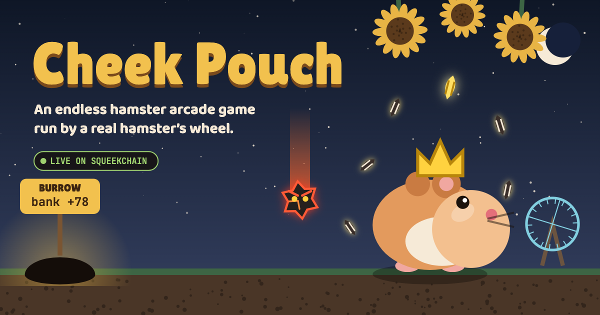

# Cheek Pouch

An endless hamster arcade game for the Squeekchain hamster economy. Stuff sunflower seeds into your cheeks, dodge angry red-hot pebbles and the cat's paw, and carry your haul home to the burrow. The bigger the haul, the bigger the payout: n seeds bank for 1+2+…+n.

**Play:** _add your site address here once it is live_

## How it uses Squeekchain

The game reads Squeekchain's public API every 8 seconds, straight from the browser:

- **Real wheel, real pace.** While Squeektoshi is running, the sky turns to day, seeds fall faster as his RPM rises, and every bank pays ×2. While he rests, the game plays at night at ×1.
- **Golden seeds.** Every increase in logged wheel work drops golden seeds (+20 each) into every open run. Each completed Squeekchain block drops a golden shower.
- **Bonus bet.** Before a run you can bet on whether the real hamster will be on his wheel when the run ends. It settles on the live feed at that moment; a stale reading cancels it.
- **Squeek perks.** Paste a wallet address to unlock cosmetic perks from real holdings: a crown (hold 1+ Squeek), sunglasses (stake 1+), a scarf (own a level 2+ Squeek) and golden fur (hold 10+). Perks never change the score.
- **Live strip.** Wheel RPM and speed, work logged, the settled round, and progress toward the next block.

Nothing is signed and no keys are handled. Endpoints used:

| Endpoint | Used for |
|---|---|
| `GET https://api.squeekchain.com/v1/status` | wheel state, RPM, speed, cumulative work, block height and progress, settled round |
| `GET https://api.squeekchain.com/v1/accounts/{address}` | Squeek counts, staked count and levels, for perks |

## Gameplay

- It never ends on a timer. You have 3 hearts, and a new level starts every 20 seconds: faster pebbles, pairs, a quicker cat, pebble storms, double swipes, then everything speeds up.
- Controls: arrow keys or A/D to run, Space or Up to hop, Enter to start, P to pause, M to toggle sound. Phones get on-screen buttons.

## Files

- `cheek-pouch.html` is the game source.
- `index.html` is the hosted page, built from the source with `python3 build.py`.
- `art/` holds the cover and icon images; `art/cover.html` draws them.
- No build tools, no dependencies, no server.

The shared leaderboard only works in the claude.ai copy of the game; on this site the board shows a note instead.
